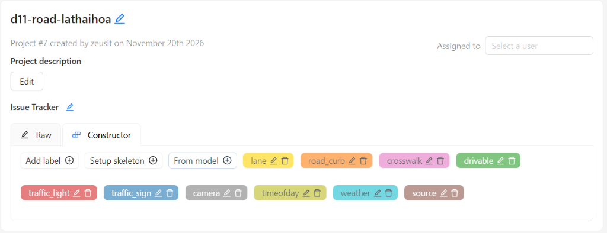
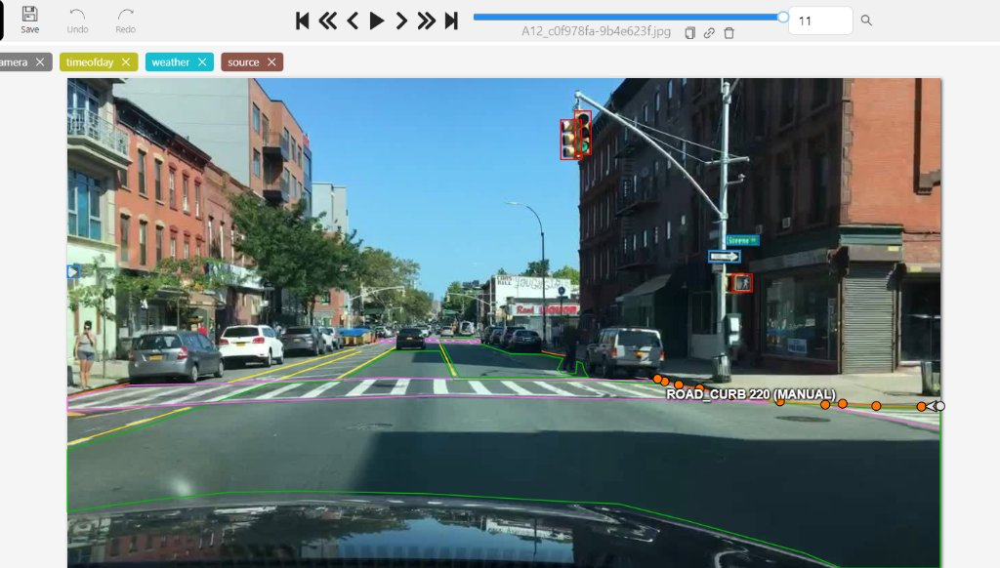
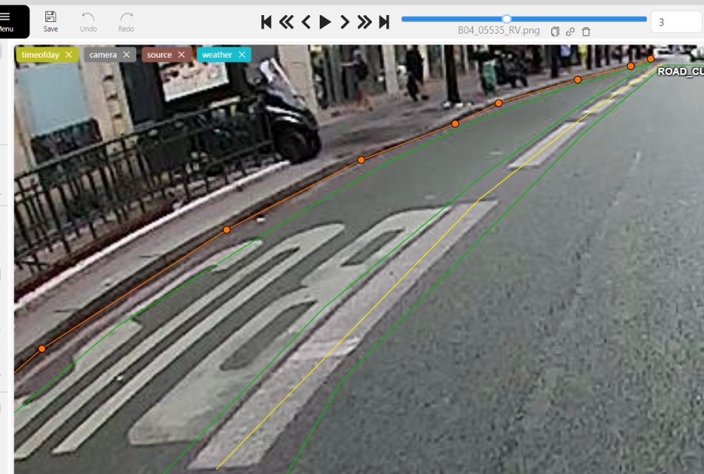

# Báo cáo cá nhân — Ngày 11
Họ tên: La Thái Hòa               Mã học viên: 2A202603069  
Phiên bản CVAT (Help → About): Server version 2.82.1 · UI version 2.82.1  
Guideline: Road v1.0    Lần nộp (`revision` trong manifest): 1  
Thời điểm export (ngày giờ trên CVAT): 2026-11-20 17:27 UTC (2026-11-21 00:27 GMT+7)    Số lần nộp lại sau Rework: 0  

## 1. Kiểm project
| Mục | Đúng như guideline Road v1.0? | Ghi chú |
| --- | --- | --- |
| 6 label, đúng kiểu | Đúng | Đủ 6 shape label trong project `d11-road-lathaihoa`: `lane` (polyline), `road_curb` (polyline), `crosswalk` (polygon), `drivable` (polygon), `traffic_light` (rectangle), `traffic_sign` (rectangle). |
| Thuộc tính và giá trị | Đúng | Nhập trực tiếp từ `configs/road_v1_labels.json` (`taxonomy.py`): `lane` (`position`, `style`, `color`, `kind`), `drivable` (`area_type`: `direct`/`alternative`), `traffic_light` (`color`: `red`/`yellow`/`green`/`off`/`unknown`, `type`: `vehicle`/`pedestrian`/`beacon`, `facing`: `front`/`side`/`back`, `edge_zone`), `traffic_sign` (`group`, `facing`, `edge_zone`). |
| 4 tag ảnh | Đúng | Đủ 4 label kiểu Tag có thuộc tính select `value`: `camera` (`front`, `fisheye_front`, `fisheye_rear`, `fisheye_left`, `fisheye_right`), `timeofday` (`day`, `dusk`, `night`), `weather` (`clear`, `overcast`, `rain`, `fog`, `other`), `source` (`real`, `simulated`). |

Cách kết thúc polyline trên bản CVAT này: Bấm phím **`N`** sau khi chấm điểm cuối (hoặc bấm **Done** trên thanh công cụ vẽ / double-click điểm cuối).  
Cách đặt tag ảnh trên bản CVAT này: Chọn công cụ **Tag** (biểu tượng thẻ ở thanh công cụ bên trái) → chọn từng label `camera`, `timeofday`, `weather`, `source` → bấm **Add tag** → mở **Details** trong bảng Objects (hoặc chọn trên thanh tag phía trên ảnh) để đổi thuộc tính `value` khỏi giá trị mặc định.

## 2. Số lượng đã gán
| Task | Ảnh | lane | road_curb | crosswalk | drivable | traffic_light | traffic_sign |
| --- | ---: | ---: | ---: | ---: | ---: | ---: | ---: |
| front | 12 | 38 | 21 | 13 | 36 | 30 | 33 |
| front-extra (đã làm 4 / 4) | 4 | 13 | 7 | 6 | 14 | 8 | 17 |
| fisheye | 8 | 12 | 22 | 14 | 14 | 8 | 11 |
| fisheye-extra (đã làm 4 / 4) | 4 | 3 | 8 | 5 | 4 | 1 | 1 |

*(Tổng hợp khớp với `lathaihoa-manifest.json`: `lathaihoa-front.zip` gồm 16 ảnh / 236 shape; `lathaihoa-fisheye.zip` gồm 12 ảnh / 103 shape; 28/28 ảnh có đủ 4 tag.)*

## 3. Bảng ca khó
| Ảnh | Nhãn | Phân vân giữa | Đã chọn | Lý do |
| --- | --- | --- | --- | --- |
| A01, A03, A04, A09, A11, A14 | `lane` | Vẽ 1 polyline chạy giữa tâm cặp vạch đôi (`kind=double`) hay vẽ 2 polyline riêng cho từng nét song song | Vẽ 2 polyline riêng (mỗi nét một polyline, cùng `position`, cùng `kind=double`) | Thực hiện theo yêu cầu trực tiếp của giảng viên hướng dẫn trên lớp; 7 cảnh báo `QC1-05` *"2 polyline cùng position"* từ `road_check lint` ở các ảnh này là đã biết trước, không phải lỗi tách vạch đứt. |
| A05 | `lane` | Ước lượng tâm đường để vẽ L1/R1 hay không vẽ `lane` | Không gán `lane`, chỉ gán `drivable` và `road_curb` | Đường không sơn vạch kẻ làn ngoài thực tế; tuân thủ quy tắc không tự bịa vạch (`QC1-02` trên A05 được miễn theo `CHECKPOINTS.md`). |
| A06, A07, A14 | `lane` | Cố vẽ thêm L1 (A06, A07) / R1 (A14) hay bỏ qua vạch không thấy được | Không gán vạch không nhìn thấy (A06 chỉ có R1; A07 bên trái là dải phân cách bê tông, chỉ vẽ `R1`/`R2`; A14 mép phải không có vạch sơn rõ) | Theo `guideline_road_v1.0.md` và `huong_dan_cvat_bang_hinh.md` mục 6, không vẽ vạch mà ảnh không có; 3 cảnh báo `QC1-02` này được miễn khi đối chiếu thực tế. |
| A03 | `lane` (`R1`) | Giữ `occluded=false` vì đoạn vẽ chủ yếu cắt qua chữ sơn `SCHOOL` hay bật `occluded=true` | Bật `occluded=true` cho vạch `R1` | Vạch `R1` bị chữ `SCHOOL` cắt ngang và bị ô tô phía trước che phần tiếp nối; khớp trực tiếp với checkpoint giữa giờ (`CHECKPOINTS.md`: *"A03 có occluded"*). |
| A10 | `lane` (`R1`) | Dừng tại `(961, 517)` trước vết giọt nước/lá trên kính lái hay kéo nối tiếp lên phía sau xe trước | Dừng tại `(961, 517)` (không kéo nối tiếp và không bật `occluded`) | Soi cận cảnh và kéo đường thẳng nối tiếp cho thấy phía trên vùng giọt nước/lá hoàn toàn là mặt nhựa đen ướt bên trái chữ `ONLY`, không thấy vạch sơn nối tiếp rõ ràng; vệt trắng nhỏ sát bánh sau xe trước bị lệch trục (thuộc vạch ngang khác) nên dừng đúng ở điểm xa nhất còn nhìn thấy vạch theo quy tắc 5. |
| A06, A12 | `traffic_light` (`type=pedestrian`) | Chọn `color=green`, `off` hay `unknown` cho đèn người đi bộ hình người màu trắng (kiểu Mỹ — WALK) | Chọn `unknown` (A06) / `off` (A12) với `type=pedestrian`, `facing=front` | Road v1.0 chỉ có 5 giá trị màu `red / yellow / green / off / unknown`, không có `white`; không chọn `green` để tránh đánh đồng màu trắng của đèn đi bộ Mỹ với đèn xanh xe cơ giới. |
| B02 | `traffic_light` | Bật hay tắt `edge_zone` cho 2 đèn ở góc trên-trái và góc trên-phải | Bật `edge_zone=true` cho cả 2 đèn ở góc trên, giữ box thẳng sát vỏ đèn | Tâm của cả 2 box đều nằm ngoài 80 % bán kính vòng ảnh fisheye (`> 512 px` từ tâm ảnh) nên bị méo góc rộng mạnh theo quy tắc Fisheye mục 4. |
| B05–B08, B10, B12 | `lane` | Gán `position=L1/R1` theo vị trí vạch so với xe hay gán `position=other` | Gán `position=other` cho mọi `lane` ở camera `fisheye_left` và `fisheye_right` | Camera hai bên thân xe không định nghĩa làn đang tiến về phía trước; tuân thủ quy tắc cứng `QC1-03` ở mục 4 guideline (`L1/R1/L2/R2` chỉ dùng cho `fisheye_front` và `fisheye_rear`). |
| B11 | `lane` / `drivable` | Gán các vạch sơn ô đỗ xe màu trắng/xanh là `lane` hay bỏ qua | Không gán `lane`, chỉ gán `drivable` và `road_curb` | Vạch ô đỗ xe không thuộc phạm vi `lane` trong Road v1.0 (mục 4 guideline: *"Vạch ô đỗ không gán lane"*). |

## 4. Phiếu QC 1 nhận được
Bạn kiểm lô của tôi: Vũ Gia Khang (`vugiakhang`)   Quyết định nhận được: **Release** *(mẫu 6 ảnh `A01`, `A03`, `A05`, `A10`, `B02`, `B03` — 97 nhãn kiểm; 0 lỗi nặng, 0 lỗi chính = 0,0 % ≤ 5 %, 0 lỗi nhẹ)*  

| Mã lỗi | Số lỗi | Đồng ý? | Đã sửa? |
| --- | ---: | --- | --- |
| QC1-02 (`A05` không có L1/R1) | 0 *(miễn)* | Đồng ý miễn | Đường thực tế không có vạch sơn; giữ nguyên không vẽ thêm theo `CHECKPOINTS.md` |
| QC1-05 (`A01`, `A03` 2 polyline cùng `position`) | 0 *(giải trình)* | Không phải lỗi | Giữ nguyên 2 nét cho vạch đôi (`kind=double`) theo yêu cầu trực tiếp của giảng viên (đã ghi Mục 3) |

**Ghi chú tự kiểm (self-QC trước khi gửi lô `revision 1`):**
- Đã khắc phục toàn bộ lỗi và cảnh báo trước khi chốt bản `revision 1`: bổ sung đủ 4 tag cho 6 ảnh thêm (`A14–A16`, `B10–B12`); sửa `camera` của `B01` từ `fisheye_rear` → `fisheye_front`; chuyển toàn bộ `lane` trên camera hai bên (`B05–B08`, `B10`, `B12`, kể cả `lane#3` ở `B06`) sang `position=other`; sửa màu đèn `facing=front` trên `A10` (`traffic_light#7`) từ `yellow` → `red` sau khi phóng to kiểm bóng trên cùng đang sáng đỏ và xóa 2 hộp biển `< 8 px` không bắt buộc trên `A10`; chỉnh màu vàng cho nét thứ 2 của vạch vàng đôi (`A03`, `A11`, `A14`); bật `occluded=true` cho `R1` ở `A03`; bật `edge_zone=true` cho 2 đèn ngoài vòng 80 % ở `B02`; tăng mật độ điểm cong cho polyline fisheye ở `B09`, `B12` và chuẩn hóa chiều gần → xa ở `B06`, `B12`.
- Kết quả `road_check lint` trên bản nộp `revision=1`: `lathaihoa-fisheye.zip` đạt **0 cảnh báo**; `lathaihoa-front.zip` đạt **0 cảnh báo nhẹ** và chỉ còn 5 cảnh báo `QC1-02` ở các ảnh không thấy vạch (`A05`, `A06`, `A07`, `A14`) cùng 7 cảnh báo `QC1-05` do vẽ 2 nét vạch đôi theo yêu cầu giảng viên.

## 5. Kiểm file export
| File | Mở lại được? | Số shape ảnh 1 (job / file) | Số shape ảnh 2 (job / file) | Tag camera có trong XML? |
| --- | --- | --- | --- | --- |
| `lathaihoa-front.zip` | Có (`road_check lint` PASS, `contains_images: false`) | 10 / 10 (`A01`, thêm 4 tag = 14 mục trên CVAT) | 7 / 7 (`A02`, thêm 4 tag = 11 mục trên CVAT) | Có (`camera=front`, đủ 16/16 ảnh) |
| `lathaihoa-fisheye.zip` | Có (`road_check lint` PASS, `contains_images: false`) | 6 / 6 (`B01`, thêm 4 tag = 10 mục trên CVAT) | 14 / 14 (`B02`, thêm 4 tag = 18 mục trên CVAT) | Có (`fisheye_front/rear/left/right`, đủ 12/12 ảnh) |

*(Ghi chú đối chiếu nhanh trên 2 ảnh chụp màn hình: `A12` có 19 shape + 4 tag = 23 mục; `B03` có 19 shape + 4 tag = 23 mục — khớp 100 % giữa CVAT và XML.)*

## 6. Ảnh chụp màn hình
1. Tab Labels của project `d11-road-lathaihoa` (và hộp thoại Help → About xác nhận CVAT 2.82.1):  
     
   
2. Một ảnh camera trước đã gán đủ (làn, vùng lái, đèn/biển — `A12_c0f978fa-9b4e623f.jpg`):  
   
3. Một ảnh fisheye đã gán, phóng to đoạn polyline cong (`B04_05535_RV.png` — thấy rõ các nút điểm `road_curb` và `lane` uốn bám sát theo cung cong fisheye, đủ 4 tag ảnh):  
     
   *(Kèm ảnh toàn cảnh fisheye `B03_04267_RV.png`: `docs/screenshots/fisheye_B03.jpg`)*
4. Một đoạn XML có `<polyline label="lane">` (trích trực tiếp từ `annotations.xml` trong `lathaihoa-front.zip`, ảnh `A01_bc5fadac-fa6dd225.jpg`):
```xml
<polyline label="lane" source="manual" occluded="0" z_order="0" points="0.30,603.20;81.80,578.90;130.40,563.90;175.20,550.30;217.65,537.76;263.80,524.50;296.10,515.80;325.15,507.90">
  <attribute name="position">L2</attribute>
  <attribute name="style">solid</attribute>
  <attribute name="color">white</attribute>
  <attribute name="kind">double</attribute>
</polyline>
```

## 7. Tự đánh giá
Lỗi bạn mắc nhiều nhất hôm nay (theo mã QC1-xx), và cách tránh ở Ngày 20:  
- Mắc nhiều nhất ở lượt gán đầu là **QC1-03** (quên đổi `position` sang `other` ở camera hai bên fisheye và để sót giá trị mặc định `L1` của CVAT) cùng **QC1-01** (quên gắn đủ 4 tag trên các ảnh `extra` và gán nhầm `fisheye_rear` cho ảnh `FV`).
- Cách tránh ở Ngày 20: Luôn làm đúng thứ tự chuẩn ở mục 2 guideline — **đặt và mở Details kiểm 4 tag trước tiên** (đối chiếu hậu tố `FV/RV/MVL/MVR` trước khi vẽ bất kỳ hình nào); vẽ xong mỗi shape mở ngay **Details** sửa thuộc tính mặc định (`L1 / solid / white / single`, `direct`, `edge_zone`); luôn dành 5 phút cuối chạy `road_check lint` để tự bắt lỗi trước khi Finish job.

Nhãn của bạn đi vào model ở đâu? Chọn một lỗi đã sửa và nói nó làm model học sai thế nào:  
- Nhãn của bài lab đi trực tiếp vào tập huấn luyện (ground truth) cho các mô hình nhận thức phần tử đường của hệ thống ADAS/xe tự hành: `lane` làm đích cho mô hình phát hiện làn (row-anchor / segmentation) phục vụ **LKA (Lane Keeping Assist)**; `drivable` và `crosswalk` cho phân đoạn mặt đường & quy hoạch quỹ đạo; `traffic_light` / `traffic_sign` cho phát hiện tín hiệu điều khiển; và 4 tag ảnh dùng để phân tầng dữ liệu theo **ODD (Operational Design Domain)** và camera trong hệ thống **SVM (Surround View Monitoring)**.
- **Ví dụ một lỗi đã sửa — lỗi `QC1-01` gán nhầm `camera=fisheye_rear` cho ảnh `B01_02688_FV.png` (và `QC1-03` để `position=R1` trên camera bên trái `B06`):** Trong pipeline huấn luyện multi-camera SVM, tag `camera` quyết định ma trận hiệu chuẩn nội/ngoại (extrinsic/intrinsic) để chiếu nhãn 2D lên bản đồ **BEV (Bird's-Eye View)** quanh xe. Nếu ảnh camera trước bị gắn nhãn là camera sau, toàn bộ vạch làn, lề đường và vùng lái của khung hình đó bị chiếu ngược 180° ra phía sau xe; còn nếu vạch nằm ngang ở camera hông (`B06`) bị gán là `R1`, đầu phân loại ego-lane sẽ nhận nhầm mép vỉa hè bên hông là vạch biên phải làn đang đi, làm sai lệch hàm loss phân loại làn và dẫn đến ước lượng lệch tâm làn (lateral offset) nguy hiểm cho bộ điều khiển LKA.

## 8. (Tùy chọn, buffer) Từ polyline đến đích row-anchor
*(Số liệu trích trực tiếp từ `python -m road_lab.rowanchor <file>-front.zip --image A01 --position R1` — của chúng tôi: `lane#1@(719,720)`; của bạn `vugiakhang`: `lane#5@(703,717)`.)*

| y | 720 | 680 | 640 | 600 | 560 |
| --- | ---: | ---: | ---: | ---: | ---: |
| x của chúng tôi | 719.1 | 660.5 | 601.9 | 543.4 | 484.8 |
| x của bạn kia (`vugiakhang`) | không có làn | 658.2 | 601.9 | 544.9 | 486.9 |

Trả lời 3 câu:

1. Năm số x đó chính là đích mà một model row-anchor học cho vạch này. Nếu bạn dừng polyline sớm 40 px, hàng nào đổi thành "không có làn"?  
   - Nếu dừng polyline sớm 40 px ở đầu xa (vạch kết thúc trước `y=560` thay vì kéo tới `y=523`), hàng **`y = 560`** sẽ rơi ra ngoài đoạn polyline và đổi thành **"không có làn"**. Tương tự ở đầu gần đáy ảnh, chỉ cần điểm đầu chấm hụt lên trên `y=720` (như bài của `vugiakhang` bắt đầu ở `y=717`, hụt 3 px) là hàng **`y = 720`** lập tức trở thành **"không có làn"**.

2. So với bạn được kiểm (cùng ảnh): ở hàng 720 và hàng 560, hai bạn lệch nhau bao nhiêu pixel? Lệch ở hàng nào ảnh hưởng LKA nhiều hơn (slide 25)?  
   - Ở hàng **`y = 720`**: chúng tôi là `719.1` còn bạn `vugiakhang` là **"không có làn"** do điểm đầu đặt tại `(703, 717)` (cách mép đáy 3 px; tại hàng gần nhất có chung giá trị là `y = 680`, hai bạn lệch `|660.5 - 658.2| = 2.3 px`). Ở hàng **`y = 560`**: hai bạn lệch `|484.8 - 486.9| = 2.1 px` (còn tại `y = 640` trùng khít `0.0 px`).
   - **Lệch (hoặc mất nhãn) ở hàng `y = 720` ảnh hưởng LKA nhiều hơn** (theo slide 25): hàng `y = 720` là vùng sát mũi xe nhất, quyết định trực tiếp sai số lệch ngang tức thời (lateral offset) của xe so với tâm làn; mất điểm neo hoặc sai số ngay sát xe làm bộ điều khiển phản hồi lệch/giật tức thời, trong khi vùng xa (`y = 560`) được làm mượt dần theo tầm nhìn trước (look-ahead).

3. Nếu polyline vẽ từ xa về gần (ngược quy tắc 2), cách tính trên có đổi không? Script nào sẽ gặp khó?  
   - Về mặt nội suy hình học từng đoạn thẳng `x_at_y`, kết quả 5 tọa độ `x` **không đổi** vì tập các đoạn nối giữa hai điểm liên tiếp là như nhau.
   - Tuy nhiên, **`road_check.py`** sẽ bắt lỗi ngược chiều (`QC1-04`: điểm đầu cao hơn điểm cuối) và **`rowanchor.py`** in cảnh báo *"polyline đầu tiên vẽ từ xa về gần"*; ngoài ra các script tiền xử lý huấn luyện giả định mảng điểm sắp xếp đơn điệu từ đáy ảnh lên trên (để lấy điểm gốc sát xe, nội suy nhị phân theo `y` giảm dần hoặc tính vector tiếp tuyến theo hướng di chuyển) sẽ đọc sai thứ tự và lỗi logic.
